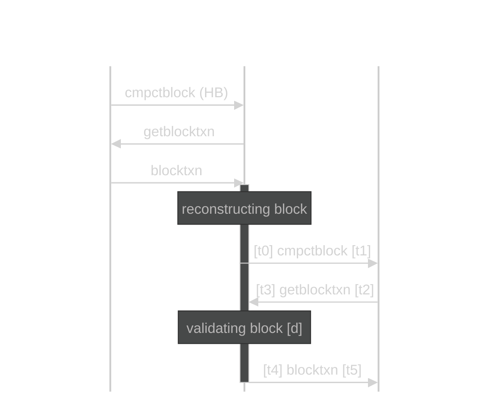

# Block propagation and validation duration during slow-to-validate blocks on Signet

b10c | 2026-04-15 13:57:48 UTC | #1

During last week’s [demonstration of slow blocks on Signet](https://delvingbitcoin.org/t/consensus-cleanup-demo-of-slow-blocks-on-signet/2367), I ran a custom P2P client that connected to all \~190 listening Signet nodes on IPv4 and Tor. The goal was to measure block **propagation speed through the network** as well as block **validation speed on a per node basis**.

The results show that block propagation was significantly impacted as the nodes need to wait for the previous peer to validate the block first in order to receive the \`blocktxn\` response with the missing transaction that allows to start reconstructing, validating, and forwarding it. With the far-from-worst-case slow-to-validate blocks, a validation slowdown of about \~160x for the median peer could be observed. The median peer took about 20s to validate a slow-to-validate block, while a normal block on Signet would take the node 176ms.

## Methodology

To measure block propagation and validation speed, two kinds of announcement events from peers are interesting:

First, the [BIP-152](https://github.com/bitcoin/bips/blob/master/bip-0152.mediawiki) high-bandwidth compact block announcement. After we request high-bandwidth compact blocks from peers with `sendcmpct(1)`, the peers will send us a `cmpctblock` message as soon as they have reconstructed the block but **before** validating the block. As soon as our client receives a `cmpctblock` announcement from the peer, it requests a transaction from the block via the `getblocktxn` message. Once the peer has validated the block, it responds with a `blocktxn` message. By recording the timestamps of the `cmpctblock` and `blocktxn` message arrivals, we can later infer the validation time. The `cmpctblock` timestamps also inform us about the block propagation speed without the validation time.

Secondly, the low-bandwidth compact block INV (or similarly the [BIP-130](https://github.com/bitcoin/bips/blob/master/bip-0130.mediawiki) headers) announcements are interesting. These happen **after** the node has validated the block.

The custom P2P client also records the Bitcoin protocol `ping`-`pong` round-trip-time (RTT) to the peers to be able to adjust the announcement timestamps for network and application layer latency.

The block propagation duration is the difference between the announcement timestamp and the first announcement timestamp we received for this block. Both timestamps are RTT-adjusted with ½ RTT: `ts_adjusted = ts_raw - 0.5 * RTT`. We assume the RTT is symmetric ^[This might not be the case on Tor.].

The validation duration is the difference between the peer sending us the high-bandwidth compact block announcement and it sending us the corresponding `blocktxn` response ^[In some cases, especially when multiple slow-to-validate compact blocks arrived at the peer and were queued up for validation, we only receive a response to our getblocktxn after the validation of all queued up blocks is done. In these cases, I used the time of next compact block announcement. These are sent before the next block validation starts.]. We don’t know the timestamps of when the peer sent us a message, but can calculate it from the timestamp when receiving using the RTT. The timings are:



* `t0`: peer finishes reconstruction and sends a high-bandwidth compact block announcement to us
* `t1`: we receive a compact block announcement (\~0.5 RTT after t0)
* `t2`: we send getblocktxn request (assumed to be instant)
* `t3`: peer receives getblocktxn request (\~0.5 RTT after t2)
* `t4`: peer finishes validation and sends blocktxn (variable)
* `t5`: we receive blocktxn (\~0.5 RTT after t4)

We want to measure the time between `t0` and `t4` (= `d`). We have `t1` (and `t2`), `t5` and the RTT between us and the peer. However, since we have to do one full round-trip between `t0` and `t4`, when the block validates faster than our RTT to the peer, we can only get an upper-bound on validation time. In this case, `d ≈ RTT`.

```
t0 = t1 - (0.5 RTT)
t2 = t1
t3 = t1 + (0.5 RTT)
t4 = t5 - (0.5 RTT)

d = t4 - t0
longer_than_rtt = d > RTT
```

As RTT we use the median RTT based on what we’ve recorded during the connection lifetime.

## Results

### Block propagation

For block propagation, we look at the times when the peers announced the block as high-bandwidth compact block and via an INV. We also differentiate between the normal blocks and the specially crafted slow-to-validate blocks.


For both validation speeds, the normal and slow-to-validate block, the high-bandwidth compact block announcements propagated faster than the inv announcements. This is expected, as high-bandwidth compact block announcements are sent before the block is validated and the INV announcements are sent only once the block is validated.

For the normal blocks, the propagation times of compact blocks (green) and INVs (blue) are similar on Signet. The normal blocks on Signet usually don’t contain many transactions and can be validated fast. The 25th percentile of peers announces the blocks to us after 150ms, the median peer after a little more than 200ms, and the 75th percentile after about 300ms. After 600ms, more than the 90th percentile of peers have validated the block and sent an announcement to us.


The slow-to-validate blocks propagate very differently. While high-bandwidth compact block announcements (yellow) arrive before the INV announcements, the 25th percentile of peers had sent us a high-bandwidth compact block only after nearly 14s and the INVs for these arrived only after 27.5s. The median peer sent us the compact block announcement after nearly 26s and the INV after 31.7s. For the 75th percentile it’s 31.7s for compact blocks and 55s for the INV. The 90th percentile peers announced the slow-to-validate blocks only after 58s via compact blocks and 114s via INVs.

This indicates that block propagation speed depends on the validation performance. Blocks that are fast to validate also propagate faster while slow-to-validate blocks propagate slower. This seems reasonable, as a node will validate a block first before it passes it along. However, note that this slow-down only exists if the node needs to request a transaction with `getblocktxn`. If a node doesn’t need to request a transaction because it, for example, already had it in it’s mempool, it can start to validate the block as soon as it received the `cmpctblock` message and reconstructed the block. The slow-to-validate transaction in the slow blocks is non-standard and needs to be requested with a `getblocktxn`. If compact block prefilling is implemented, for example, as discussed in https://delvingbitcoin.org/t/stats-on-compact-block-reconstructions/1052/24 , slow-to-validate blocks might propagate faster. In this demonstration case, the blocks contained a single, 999kvB large, slow-to-validate transaction. Prefilling this transaction likely wouldn’t make sense as it’s too large.

### Block validation

To measure block validation durations, we only look at high-bandwidth compact block announcements and `blocktxn` responses. Specifically, we use the duration `d` with `d = t4 - t0` as defined above. When the actual validation duration is lower than the assumed RTT, our measured validation is only an upper-bound of the real validation duration. This means, the actual validation duration might be shorter than what we measured.


The graph shows the validation time of normal blocks and the crafted slow-to-validate blocks. On some of the normal blocks, we have only an upper-bound and the actual validation time might be faster.

The measured validation time of normal blocks on Signet mostly ranges from 10ms to about 2s. The validation times of the slow-to-validate blocks ranges from about 2.5s to 5 minutes.


For the normal blocks (including the upper-bound measurements), the 25th percentile of block validation duration is 37ms, the 50th percentile is 176ms, the 75th percentile is 447ms, and the 90th percentile is 740ms. Most listening nodes on the Signet network validate the normal blocks in less than a second.

For the slow-to-validate blocks, the 25th percentile is 8.2s, the 50th percentile is 19.7s, the 75th percentile is 32s, and the 90th percentile is 78.3s.

To get a feeling for how much slower the slow-to-validate blocks are per peer, we can calculate a baseline from the normal blocks by using the median validation duration. Then, we can compare this to the median validation duration of the slow-to-validate blocks and can calculate a multiple.


The 10th percentile of my peers was 13.5x slower, the 25th 31x slower, the 50th percentile was 159.4x slower, the 75th 793x slower and the 90th percentile was 1156x slower. The listening nodes on Signet seem to have a large difference in validation performance for these slow blocks.

While looking at these numbers, we have to keep in mind that these are only the slow-to-validate blocks @Antoine chose to disclose and that there are far worse blocks that someone could construct.

## Accuracy of the measurement method

To verify that our measurement method is accurate, we can look at a `-debug=bench -debug=validation -debug=net -logtimemicros=1` debug.log of a Bitcoin Core node and compare the actual validation times to the measured validation times.

The following debug.log snippet shows the first slow-to-validate block during the first run of https://delvingbitcoin.org/t/consensus-cleanup-demo-of-slow-blocks-on-signet/2367  my monitoring node. I added four markers (`[m1]`, `[m2]`, `[m3]`, and `[m4]`) to it.

```
2026-04-08T14:05:12.292703Z [msghand] [cmpctblock] Successfully reconstructed block 0000000eb552c9f26e712d546c71297fd0623890299b40e7ada81d2dc32f5d0b with 1 txn prefilled, 0 txn from mempool (incl at least 0 from extra pool) and 1 txn (999557 bytes) requested
2026-04-08T14:05:12.292795Z [msghand] [cmpctblock] Reconstructed block 0000000eb552c9f26e712d546c71297fd0623890299b40e7ada81d2dc32f5d0b required tx 1b44e7f59d39e4d53b4c4a77a650561de1871fe962fe6a17d1a302b877b2cb48
[m1] 2026-04-08T14:05:12.422939Z [msghand] [validation] NewPoWValidBlock: block hash=0000000eb552c9f26e712d546c71297fd0623890299b40e7ada81d2dc32f5d0b
2026-04-08T14:05:12.423680Z [msghand] [net] PeerManager::NewPoWValidBlock sending header-and-ids 0000000eb552c9f26e712d546c71297fd0623890299b40e7ada81d2dc32f5d0b to peer=5
2026-04-08T14:05:12.423794Z [msghand] [net] sending cmpctblock (358 bytes) peer=5
2026-04-08T14:05:12.543864Z [msghand] [bench]   - Using cached block
2026-04-08T14:05:12.543926Z [msghand] [bench]   - Load block from disk: 0.07ms
2026-04-08T14:05:12.543962Z [msghand] [bench]     - Sanity checks: 0.01ms [0.00s (0.01ms/blk)]
2026-04-08T14:05:14.166485Z [msghand] [bench]     - Fork checks: 1622.48ms [1.96s (93.29ms/blk)]
2026-04-08T14:05:14.643331Z [msghand] [bench]       - Connect 2 transactions: 476.84ms (238.419ms/tx, 1.189ms/txin) [0.69s (32.64ms/blk)]
2026-04-08T14:06:33.383188Z [msghand] [bench]     - Verify 401 txins: 79216.70ms (197.548ms/txin) [79.43s (3782.32ms/blk)]
2026-04-08T14:06:33.385563Z [msghand] [bench]     - Write undo data: 2.39ms [0.07s (3.19ms/blk)]
2026-04-08T14:06:33.385643Z [msghand] [bench]     - Index writing: 0.11ms [0.00s (0.08ms/blk)]
2026-04-08T14:06:33.385754Z [msghand] [validation] BlockChecked: block hash=0000000eb552c9f26e712d546c71297fd0623890299b40e7ada81d2dc32f5d0b state=Valid
2026-04-08T14:06:33.385862Z [msghand] [bench]   - Connect total: 80841.94ms [81.46s (3879.22ms/blk)]
2026-04-08T14:06:33.832999Z [msghand] [bench]   - Flush: 447.07ms [0.51s (24.52ms/blk)]
2026-04-08T14:06:33.833198Z [msghand] [bench]   - Writing chainstate: 0.27ms [0.00s (0.19ms/blk)]
2026-04-08T14:06:33.833668Z [msghand] [validation] Enqueuing MempoolTransactionsRemovedForBlock: block height=299177 txs removed=0
2026-04-08T14:06:33.833839Z [msghand] UpdateTip: new best=0000000eb552c9f26e712d546c71297fd0623890299b40e7ada81d2dc32f5d0b height=299177 version=0x20000000 log2_work=43.630312 tx=29147716 date='2026-04-08T14:03:39Z' progress=1.000000 cache=15.3MiB(114240txo)
2026-04-08T14:06:33.833856Z [msghand] [bench]   - Connect postprocess: 0.66ms [1.57s (74.55ms/blk)]
[m2] 2026-04-08T14:06:33.833868Z [msghand] [bench] - Connect block: 81290.01ms [83.55s (3978.55ms/blk)]
2026-04-08T14:06:33.833926Z [msghand] [validation] Enqueuing BlockConnected: block hash=0000000eb552c9f26e712d546c71297fd0623890299b40e7ada81d2dc32f5d0b block height=299177
2026-04-08T14:06:33.833962Z [msghand] [validation] Enqueuing UpdatedBlockTip: new block hash=0000000eb552c9f26e712d546c71297fd0623890299b40e7ada81d2dc32f5d0b fork block hash=0000000bc5d91380fa9188acfabd6a59244e8e6e744b0a0ef07064968027e256 (in IBD=false)
2026-04-08T14:06:33.834043Z [msghand] [validation] ActiveTipChange: new block hash=0000000eb552c9f26e712d546c71297fd0623890299b40e7ada81d2dc32f5d0b block height=299177
[m3] 2026-04-08T14:06:33.834887Z [msghand] [net] received: headers (82 bytes) peer=10
2026-04-08T14:06:33.835052Z [msghand] [net] sending ping (8 bytes) peer=10
2026-04-08T14:06:34.062891Z [scheduler] [validation] MempoolTransactionsRemovedForBlock: block height=299177 txs removed=0
2026-04-08T14:06:34.063548Z [scheduler] [validation] BlockConnected: block hash=0000000eb552c9f26e712d546c71297fd0623890299b40e7ada81d2dc32f5d0b block height=299177
2026-04-08T14:06:34.063728Z [scheduler] [validation] UpdatedBlockTip: new block hash=0000000eb552c9f26e712d546c71297fd0623890299b40e7ada81d2dc32f5d0b fork block hash=0000000bc5d91380fa9188acfabd6a59244e8e6e744b0a0ef07064968027e256 (in IBD=false)
[m4] 2026-04-08T14:06:34.461329Z [msghand] [net] received: headers (82 bytes) peer=4
2026-04-08T14:06:34.461786Z [msghand] [net] sending ping (8 bytes) peer=11
... -> p2p communication continues
```

* `[m1]`: at `2026-04-08T14:05:12.422939` the `NewPoWValidBlock` marks the start of the validation of the block
* `[m2]`: at `2026-04-08T14:06:33.833868` the bench logging prints `Connect block: 81290.01ms`
* `[m3]`: at `2026-04-08T14:06:33.834887` the P2P communication briefly continues
* `[m4]`: at `2026-04-08T14:06:34.461329` we are finished with `UpdatedBlockTip` and the P2P communication continues fully

The delta between `[m1]` and `[m4]` is: 82038ms while we measured 82049ms (Δ 11ms). Looking at the first run shows that the difference between these isn’t always this small:

| measured | actual (from log) | delta | error | block |
|---:|---:|---:|---:|:---|
| 82049ms | 82038ms | 11ms | 0.013% | 0000000eb552c9f26e712d546c71297fd0623890299b40e7ada81d2dc32f5d0b |
| 82478ms | 81814ms | 664ms | 0.81% | 000000002b3a132836666c18f5e1a9d93623d3797316a968ee54e47fb44c0c13 |
| 76937ms | 76368ms | 569ms | 0.74% | 00000006d34037534a517f9e5809a34766f1540c0e6817eac91b1adfee50cb5f |
| 79382ms | 78667ms | 715ms | 0.90% | 00000014a4cae4501f98539b45c76059c706a82b77f19a9adf365b3f5e989444 |
| 79894ms | 78571ms | 1323ms | 1.68% | 00000003220437cb8b5a2edef6be828c5cdad114b1b642d724ac6f3caa7f12fb |
| 93556ms | 93541ms | 15ms | 0.016% | 000000143c97bf0134c5cf0881dfd4ef458529b7388cacf43981ffe92fb96856 |

The higher measurement errors for the blocks in the middle likely originate from a large backlog of P2P messages that needed to be processed by the node first, before it would respond to our `getblocktxn` message or announce the next compact block to us. A measurement error of about 1% is OK here. Note that this doesn’t confirm that the timings for all peers are accurate.

## Conclusion

We are able to measure the propagation speed of high-bandwdith compact block and INV announcements through the network of the listening nodes on the Signet network. During the slow-to-validate block event, blocks propagated a lot slower due to being broadcast at the same time.

We were also able to measure block validation duration. During normal network conditions on Signet, blocks sometimes validate faster than the RTT with our peers. For these, we can only measure an upper-bound in validation time. For the slow-to-validate blocks, we were able to measure a 50th percentile slowdown of about 160x compared to the validation time with the disclosed slow blocks. The slow-to-validate blocks take in median about 20s to validate.

Future work could explore block propagation and validation durations on mainnet.

-------------------------

b10c | 2026-04-15 16:39:40 UTC | #2

I’ve used the following Jupyter notebook to generate the plots for this research. If you want to validate or extend this, feel free to do so: https://gist.github.com/0xB10C/75bb5cce79e83057cae31ef06b531dea. The notebook should run just fine in Google Colab.

-------------------------

ajtowns | 2026-04-15 19:25:05 UTC | #3

[quote="b10c, post:1, topic:117"]
Prefilling this transaction likely wouldn’t make sense as it’s too large.
[/quote]

Does that make sense? I think if we had a 999kB coinbase tx we would prefill it, despite it being large. cf https://delvingbitcoin.org/t/stats-on-compact-block-reconstructions/1052/45?u=ajtowns perhaps, which proposed for HB peers to prefill txs they expect the recipient doesn't have in ways that reduce overlap.

-------------------------

b10c | 2026-04-29 08:18:49 UTC | #4

I was assuming that falling back to low-bandwidth or even non-compact block relay would be better in the case of a very large prefilled transaction (or even a large prefilled coinbase transaction). If we have three HB peers that send us a compact block with a very large transaction prefilled, we have 3x the download bandwidth usage, and are likely hitting the TCP window size? While non-high bandwidth block relay might still be a bit slower, ideally we wouldn't download the same prefilled data 3x? I think this is a speed/bandwidth trade-off.

-------------------------

ajtowns | 2026-04-30 08:06:29 UTC | #5

I wonder what the TCP window size is in practice? I guess there's no tools like `netstat` that let you observe that?

I was more thinking that having a target prefill size of about the TCP window size, then if there's more block data that would be good to prefill, having each high bw connection choose a different subset of tx data for their prefill would be good, rather than limiting the size per se.

-------------------------

b10c | 2026-05-06 08:56:09 UTC | #6

[quote="ajtowns, post:5, topic:117"]
I wonder what the TCP window size is in practice? I guess there’s no tools like `netstat` that let you observe that?
[/quote]

There is! `ss -tipn '( sport = :8333 or dport = :8333 )'` shows a bunch of information on the connection along with `snd_wnd` and `rcv_wnd` showing the window size.

[quote="ajtowns, post:5, topic:117"]
I was more thinking that having a target prefill size of about the TCP window size, then if there’s more block data that would be good to prefill, having each high bw connection choose a different subset of tx data for their prefill would be good, rather than limiting the size per se.
[/quote]

That's what @davidgumberg has been working on. Since TCP window sizes vary a lot across our connections and might change over time, (my understanding is) the currently favored approach is to cache a coinbase-only prefilled block and a prefilled block (from what we needed to request or use from the prefill we received; up to a certain size) and then decide while sending if the window size allows for sending the prefilled or the coinbase only block. My understanding is that he saw significantly better reconstructions with this.

-------------------------

ajtowns | 2026-05-07 13:23:01 UTC | #7

[quote="b10c, post:6, topic:117"]
There is! `ss -tipn '( sport = :8333 or dport = :8333 )'` shows a bunch of information on the connection along with `snd_wnd` and `rcv_wnd` showing the window size.
[/quote]

Oh, nice! I only see snd_wnd, not rcv_wnd though. 60k to 1M seems to be 85% of my range, with 10% between 1M-6M and 5% between 5k and 60k, give or take.

-------------------------

